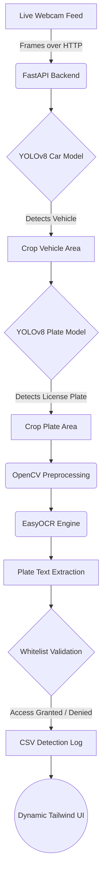

# AI Gateman

### Overview
Manual gate logging is slow, error-prone, and poses significant security risks. **AI Gateman** is a real-time, edge-optimized Automatic Number Plate Recognition (ANPR) dashboard that I developed as a personal project to instantly detect approaching vehicles, extract their license plates using computer vision, and automatically log entry/exit data.

### System Architecture 
Below is the system architecture demonstrating the core feature workflow:



### Tech Stack
* **Frontend UI**: HTML5, Vanilla JavaScript, Tailwind CSS (Dark Mode), Lucide Icons
* **Backend API**: Python, FastAPI, Uvicorn
* **AI & Computer Vision**: YOLOv8 (Ultralytics), EasyOCR, OpenCV (cv2), Pillow
* **Storage**: Local CSV (`detection_log.csv`) and plain text whitelists.

### How to Run It

1. **Clone the Repository**
   ```bash
   git clone https://github.com/arpitb496-cpu/Gateman.git
   cd Gateman
   ```

2. **Setup the Python Environment**
   Ensure you have Python installed, then create and activate a virtual environment:
   ```bash
   python -m venv venv
   # On Windows:
   venv\Scripts\activate
   # On Mac/Linux:
   source venv/bin/activate
   ```

3. **Install Dependencies**
   ```bash
   pip install fastapi uvicorn ultralytics easyocr opencv-python pillow python-multipart openpyxl
   ```

4. **Start the AI Backend Server**
   ```bash
   cd backend
   python -m uvicorn main:app --port 8000
   ```

5. **Start the Frontend Dashboard**
   Open a new terminal in the `frontend` folder and run:
   ```bash
   python serve.py
   ```

6. **View the Application**
   Open your browser and navigate to `http://localhost:3000`. Select your webcam from the dropdown and click "Start" to begin live detection!

### Future Roadmap
* **Database Migration**: Transition from flat CSV logging to a robust SQL database (e.g., PostgreSQL) for advanced querying and analytics.
* **Low-Light Optimization**: Implement image enhancement pipelines (like CLAHE) to boost plate readability during night-time operations.
* **IoT Hardware Integration**: Connect the backend to physical relays (via Raspberry Pi or ESP32) to automatically lift boom barriers upon whitelist authorization.
* **Multi-Camera Scalability**: Optimize the FastAPI backend to process concurrent streams from multiple entry and exit gates simultaneously.
