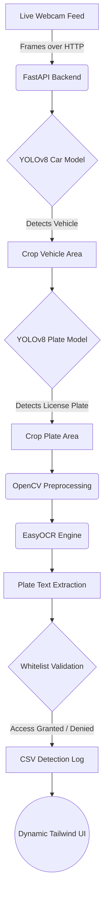

# AI Gateman

### Overview
Manual gate logging is slow, error-prone, and poses significant security risks. **AI Gateman** is a real-time, edge-optimized Automatic Number Plate Recognition (ANPR) dashboard that I developed as a personal project to instantly detect approaching vehicles, extract their license plates using computer vision, and automatically log entry/exit data.

### System Architecture 
Below is the system architecture demonstrating the core feature workflow:



### Tech Stack
* **Frontend UI**: HTML5, Vanilla JavaScript, Tailwind CSS (Dark Mode), Lucide Icons
* **Backend API**: Python, FastAPI, Uvicorn
* **AI & Computer Vision**: YOLOv8 (Ultralytics), EasyOCR, OpenCV (cv2), Pillow
* **Storage**: Local CSV (`detection_log.csv`) and plain text whitelists.

### How to Run It

1. **Clone the Repository**
   ```bash
   git clone https://github.com/arpitb496-cpu/Gateman.git
   cd Gateman
   ```

2. **Setup the Python Environment**
   Ensure you have Python installed, then create and activate a virtual environment:
   ```bash
   python -m venv venv
   # On Windows:
   venv\Scripts\activate
   # On Mac/Linux:
   source venv/bin/activate
   ```

3. **Install Dependencies**
   ```bash
   pip install fastapi uvicorn ultralytics easyocr opencv-python pillow python-multipart openpyxl dill requests
   ```

4. **Configure Environment Variables & Authentication**
   The backend enforces Bearer token authentication on all protected endpoints (refusing to start if `GATEMAN_ADMIN_TOKEN` is unset or shorter than 16 characters):
   ```bash
   export GATEMAN_ADMIN_TOKEN="your_secure_admin_token_min_16_chars"
   ```

   **Data Directory & Whitelist Setup (`GATEMAN_DATA_DIR`):**  
   All persistent data files (`whitelist.txt`, `detection_log.csv`, and `audit_log.csv`) are stored in the directory defined by `GATEMAN_DATA_DIR` (defaults to the project root; configured to `/data` with a volume in Docker):
   ```bash
   export GATEMAN_DATA_DIR="/path/to/data/dir"
   ```
   - **`whitelist.txt` is not tracked in git**: To configure authorized vehicles, copy `whitelist.example.txt` to `$GATEMAN_DATA_DIR/whitelist.txt` (or project root `whitelist.txt`) and replace the sample plates with your authorized vehicles (one per line, uppercase alphanumeric).
   - **Missing whitelist**: If `whitelist.txt` is not found, Gateman initializes an empty whitelist file and logs a warning. A missing or empty whitelist means **nobody is authorized** (`ALLOWED` access is never granted).

   **Fail-Closed Model Loading & Test Environment:**  
   - **Fail-closed startup**: If the AI models (`yolov8s.pt`, `kbest.pt`, or EasyOCR) fail to load at startup, the server logs a fatal error and immediately exits non-zero.
   - **`GATEMAN_ALLOW_NO_MODELS=1`**: Strictly reserved for the automated test suite so tests run instantly without downloading or running heavy neural network weights. In this mode, `/detect` returns HTTP 503 and `/health` returns `{"status": "degraded"}`. **Never set this variable in production**.

   **LAN & Remote Dashboard CORS Configuration:**  
   By default, CORS origins include `http://localhost:3000` and `http://127.0.0.1:3000`. If you access the sentry dashboard from another workstation or tablet on your Local Area Network (e.g. `http://192.168.1.50:3000`), you **must add your LAN dashboard origin to `CORS_ORIGINS`**:
   ```bash
   export CORS_ORIGINS="http://192.168.1.50:3000,http://localhost:3000,http://127.0.0.1:3000"
   ```

5. **Start the AI Backend Server**
   ```bash
   python -m uvicorn backend.main:app --host 0.0.0.0 --port 8000
   ```

6. **Start the Frontend Dashboard**
   ```bash
   python serve.py
   ```

7. **View the Application**
   Open your browser and navigate to `http://localhost:3000`. Enter your `GATEMAN_ADMIN_TOKEN` when prompted by the sentry dashboard, select your camera, and click "Start" to begin optical ANPR detection!

### Future Roadmap
* **Database Migration**: Transition from flat CSV logging to a robust SQL database (e.g., PostgreSQL) for advanced querying and analytics.
* **Low-Light Optimization**: Implement image enhancement pipelines (like CLAHE) to boost plate readability during night-time operations.
* **IoT Hardware Integration**: Connect the backend to physical relays (via Raspberry Pi or ESP32) to automatically lift boom barriers upon whitelist authorization.
* **Multi-Camera Scalability**: Optimize the FastAPI backend to process concurrent streams from multiple entry and exit gates simultaneously.
